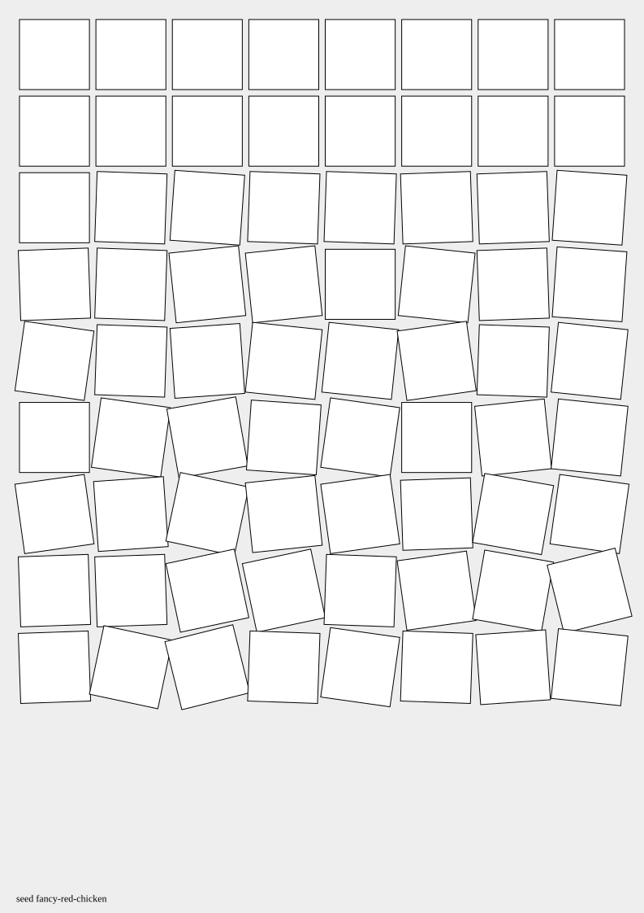

# Vormen

_Vormen_ is a bag of tools, modules and scripts for creating generative art in
SVG using Javascript

A drawing is a program: a `draw` function that takes settings and returns an SVG
string, handed to the runner as the last line. This is the code that generates
the image below ([examples/cubic-disarray.ts](examples/cubic-disarray.ts)):

```Javascript
import {
  Drawing,
  Grid,
  Noise,
  Settings,
  StandardSize,
  Vormen,
} from "@berkes/vormen";

const defaults = {
  rotationStrength: 35,
};

const draw = (rawSettings) => {
  const settings = Settings.parse(defaults, rawSettings);
  // Create a drawing with a4 size, equal margins on all sides and a white background.
  const drawing = new Drawing().withStandardSize(StandardSize.A4).withMargin(20)
    .withBackground(
      "white",
    );
  // From this drawing, we extract the area that we can draw on.
  const canvas = drawing.build();

  // Another utility is a grid. This allows us to put stuff in a grid.
  // Here we creat a 8x9 grid, each cell is padded 4 units and cells are square.
  const grid = new Grid().rows(9).columns(8).padding(4).squareCells();

  // Another utility is a seedable noise generator. Simplex noise.
  const noise = new Noise("seeeed");

  // The grit in action: loop over all cells
  grid.cells().forEach((cell) => {
    // And finally we use the svg.js API to create some rectangles
    let square = canvas
      .rect(cell.innerWidth, cell.innerHeight) // Use the grid to find the sizes of the squares
      .fill("none")
      .stroke({ width: 1, color: "black" })
      .move(cell.x, cell.y) // Use the grid to position the square
      .rotate(
        // Use the noise to randomly rotate this square
        // Apply a setting that controls how much the cells will be rotated
        noise.get(cell.x, cell.y) * (cell.row * settings.rotationStrength),
      );
  });

  return drawing.svg();
};

Vormen(draw, defaults);
```



> [!WARNING]
> This is very early, alpha code. The examples below may not be implemented yet,
> or may not work anymore.

## Quickstart

```bash
deno init my-drawing && deno add jsr:@berkes/vormen
```

## Documentation

The full documentation lives on the docs site:
**<https://berkes.github.io/vormen/>**

- [Quickstart](https://berkes.github.io/vormen/quickstart)
- [Pick and choose](https://berkes.github.io/vormen/pick-and-choose)
- [Examples](https://berkes.github.io/vormen/examples)
- [Module reference](https://berkes.github.io/vormen/modules/vormen)
- [Development](https://berkes.github.io/vormen/development) and
  [Releasing](https://berkes.github.io/vormen/releasing)

The example drawings live on the docs site's
[Gallery](https://berkes.github.io/vormen/examples) — each with its code and
rendered SVG.

## Development

The project uses Deno with `just` as the entry point: `just install`, then
`just check-all` to run all checks. See the
[development docs](https://berkes.github.io/vormen/development).

## Releases

Releases are built by CI: `just version patch|minor|major` on a clean `main`,
then `just version-push`. Pushing a `v*` tag triggers the release. See the
[releasing docs](https://berkes.github.io/vormen/releasing).
