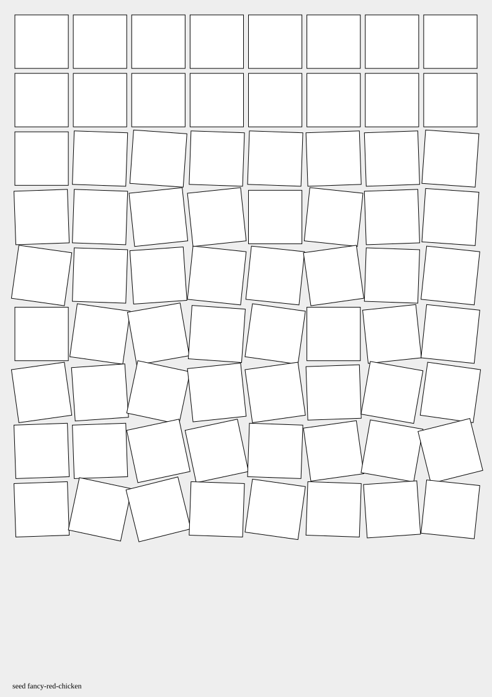

# Vormen

_Vormen_ is a bag of tools, modules and scripts for creating generative art in
SVG using Javascript

## Features

- Classes, functions and modules used in your code to easily create artwork in
  SVG.
- An optional runner module that turns your drawing into a program: render it to
  an SVG file, or serve it in a browser with a settings UI.
- Tools to run your code in a browser and interact with the SVG there

> [!WARNING]
> This is very early, alpha code. The examples below may not be implemented yet,
> or may not work anymore.

## Quickstart

> [!NOTE]
> Examples below use [deno](https://deno.com/). The final library will be usable
> on any javascript or typescript platform. node, npm, yarn, bun etc.

Create a new project and add the dependency:
`deno init my-drawing && deno add jsr:@berkes/vormen`

Edit a file, e.g. drawing.ts. Your drawing is a program: it defines a `draw`
function that takes settings and returns a `string`, then hands that function to
the runner as its last line. Here's a full example:

```Javascript
import {
  Drawing,
  Grid,
  Noise,
  Settings,
  StandardSize,
  Vormen,
} from "@berkes/vormen";

const defaults = {
  rotationStrength: 35,
};

const draw = (rawSettings) => {
  const settings = Settings.parse(defaults, rawSettings);
  // Create a drawing with a4 size, equal margins on all sides and a white background.
  const drawing = new Drawing().withStandardSize(StandardSize.A4).withMargin(20)
    .withBackground(
      "white",
    );
  // From this drawing, we extract the area that we can draw on.
  const canvas = drawing.build();

  // Another utility is a grid. This allows us to put stuff in a grid.
  // Here we creat a 8x9 grid, each cell is padded 4 units and cells are square.
  const grid = new Grid().rows(9).columns(8).padding(4).squareCells();

  // Another utility is a seedable noise generator. Simplex noise.
  const noise = new Noise("seeeed");

  // The grit in action: loop over all cells
  grid.cells().forEach((cell) => {
    // And finally we use the svg.js API to create some rectangles
    let square = canvas
      .rect(cell.innerWidth, cell.innerHeight) // Use the grid to find the sizes of the squares
      .fill("none")
      .stroke({ width: 1, color: "black" })
      .move(cell.x, cell.y) // Use the grid to position the square
      .rotate(
        // Use the noise to randomly rotate this square
        // Apply a setting that controls how much the cells will be rotated
        noise.get(cell.x, cell.y) * (cell.row * settings.rotationStrength),
      );
  });

  return drawing.svg();
};

Vormen(draw, defaults);
```

In this example, we see a lot of things coming together.

We can run it to generate an SVG:

```bash
deno run drawing.ts render --outfile drawing.svg
```

 (This is generated with
[examples/cubic-disarray.ts](examples/cubic-disarray.ts))

Or output to stdout.

```bash
deno run drawing.ts render --outfile - > drawing.svg
```

Or override settings

```bash
deno run drawing.ts render --outfile drawing.svg --settings.rotationStrength=10
```

## Examples

The [examples directory](examples/) contains runnable example drawings. Each
example has a page in [doc/examples/](doc/examples/) with a short explanation
and the SVGs it generates.

- [Cubic Disarray Example](doc/examples/cubic-disarray/README.md)
- [Noodle Love Example](doc/examples/noodle-love/README.md)

All example SVGs are generated and committed, and can be regenerated with a
single command:

```bash
just generate-examples
```

## Pick and Choose

The full example above is by no means how it must be set up. This is not a
framework. It is a library that you can pick and choose from.

Just use the runner, by passing it a function that returns the SVG as string.

```javascript
import { Vormen } from "@berkes/vormen";

const draw = (_settings) => {
  return `<svg xmlns="http://www.w3.org/2000/svg" xmlns:xlink="http://www.w3.org/1999/xlink" width="100" height="100" viewBox="0 0 100 100">
    <rect x="10" y="10" width="80" height="80" fill="red" />
  </svg>`;
};

Vormen(draw, {});
```

Or just the page builder, by letting that create the SVG string and then
`console.log()` that, or write it to a file.

```javascript
import { writeFileSync } from "node:fs";
import { Drawing, StandardSize } from "@berkes/vormen";

const drawing = new Drawing().withStandardSize(StandardSize.A4).withMargin(20);
const canvas = drawing.build();

for(i = 0, i < 8, i++) {
  for(j = 0, j < 9, j++) {
    const x = i * 10;
    const y = j * 10;
    canvas.rect(10, 10).x(x).y(y);
  }
}

writeFileSync('mydrawing.svg', drawing.svg());
```

All modules should be usable without requiring the others (this is work in
progress, some requirements exist that will be removed).

See below for a full list of modules and their usage.

## Examples

The `examples/` directory holds runnable drawings.

You can run these with `deno run examples/thefile.ts` after you check out the
source code of this repo.

## Modules

> [!WARNING]
> Modules documentation is WIP. So incomplete and probably out of date

### Vormen

Main execution module for running drawings. Contains the Vormen function,
render, and serve.

We assume `deno run drawing.ts` where `drawing.ts` uses `Vormen`.

- `deno run drawing.ts serve` will open a web app with the rendered drawing and
  a GUI with tools to play with it. Additionally, any settings will create a
  widget next to the drawing which we can adjust settings and have the drawing
  re-rendered with the changes.
- `deno run drawing.ts render --outfile file.svg` will render the svg to the
  file. Additionally, any settings can be overridden with
  `--settings.theSettingName=bar` to render with that setting instead of the
  default from the drawing.

Drawings receive their settings as a `SettingsData` record
(`Record<string, string | number | boolean>`), so the Vormen and Drawing modules
work without the Settings class. A drawing that wants typed settings parses the
record inside its draw function, e.g. with
`Settings.parse(schema, rawSettings)`.

In future, we should be able to use `node drawing.js`, `npx`, `node run`, `yarn`
or any runtime that can execute a javascript (or typescript) file.

### Drawing

The basis of SVG creation. Contains the Drawing class for building SVG artwork
with standard sizes, margins, and backgrounds. This is a simplified API that
wraps svg.js to create drawings with standard size presets (A3, A4, A5), margin
support, and background color support.

Definition elements (e.g. gradients or reusable shapes) are set with
`withDefs(elements)`, where each element is an svg.js `Element`. They are placed
in the `<defs>` of the SVG when the drawing is built. Calling `withDefs()` again
replaces the previously set elements.

### Grid

A grid system for organizing cells in a drawing. Contains Grid and Cell classes.
Grid uses the builder pattern for configuration and is iterable over its cells,
yielding Cell objects that provide position and dimension information. The grid
isn't visible, but allows us to position elements in a grid with easy tools like
being able to loop over all the cells, get X and Y coordinates of a cell, add
paddings between cells and so on. `grid.intersections()` returns all points
where the grid lines cross, including the outer edges, sorted in ascending order
by y and then by x.

### Math

Calculation utilities, randomness, and noise generation. Contains constrain,
Random, Noise, and Stringifiable.

- **constrain**: Constrains a value between a minimum and maximum
- **Random**: Seeded pseudo-random number generator with methods like between()
  and betweenFloat()
- **Noise**: Seeded Simplex noise generator for reproducible noise generation.
  Use the get(x, y) method to sample noise values.

Random and Noise are seeded, so we have reproducible results.

> [!NOTE]
> We will add many of the utilities from `p5.js`, but slightly stricter
> implemented to allow for better type checking and better documentation.

### Primitives

Geometric primitives for vector mathematics. Contains Point and Vector. These
are objects that aren't drawn, but typically used when simulating or calculating
and then drawing the results.

- **Point**: Represents a point in 2D space with x and y coordinates. Provides
  methods for vector calculations like `to()` (creates a vector between points),
  `add()` (offsets a point by a vector), `equals()` (compares points), and
  `pointAtDistanceTowards()` (finds a point at a specific distance towards
  another point).
- **Vector**: Represents a 2D vector with x and y components. Provides
  operations like `length` (Euclidean magnitude), `normalized` (unit vector),
  `scale()` (scaling), `negate()` (reversal), and `dist()` (distance between
  vectors), as well as linear interpolation via `Vector.lerp()`.

The example calculation for finding a point at distance L from point b towards
point a can be expressed as either:

```javascript
// Using the convenience method
const result = b.pointAtDistanceTowards(a, L);

// Or using chained vector operations
const back = a.to(b).normalized.scale(L).negate();
const result = b.add(back);
```

### Path

Building SVG path data strings from points, as defined in the
[w3c SVG Spec on PathData](https://www.w3.org/TR/SVG/paths.html#PathData).
Contains the PathBuilder and RoundedPathBuilder classes.

- **PathBuilder**: Builds an angular path (straight line segments) from a list
  of points. Uses the builder pattern: `new PathBuilder(points)`, optionally
  `.withClosed(true)` to close the path, then `.build()` returns the path data
  string.
- **RoundedPathBuilder**: Extends PathBuilder to draw every corner as a
  quadratic bezier curve. Set the corner radius with `.withRounding(radius)` and
  optionally `.withRoundingConstrained(true)` to shrink the radius so corners
  never overlap on close-together points.

Both builders are constructed from points, so a path built with one can be
re-drawn with the other by re-using the points, e.g.
`new RoundedPathBuilder(linearPath.points)`.

### Settings

Configuration management for drawings. Contains the Settings class for managing
drawing parameters.

Settings are declared as a schema: a plain object whose values define each
setting's canonical type (string, number or boolean) and its default. Only
strings, numbers and booleans are valid setting values; declare your schema with
the `SettingsData` type to get compile-time errors for anything else.

```javascript
const schema: SettingsData = {
  seed: "default-seed",
  strokeWidth: 1,
  enabled: true,
};

const settings = Settings.parse(schema, rawSettings);
new Random(settings.seed); // seed is a string
path.stroke({ width: settings.strokeWidth }); // strokeWidth is a number
```

`Settings.parse()` parses raw values (from the CLI, a web server, or elsewhere)
to each setting's canonical type at construction, and returns an instance that
also allows typed property access. `asRecord()` converts an instance back to a
plain `SettingsData` record.

Settings is optional: `DrawFn` and `Vormen` do not depend on it. Drawings
receive their settings as a `SettingsData` record
(`Record<string, string |
number | boolean>`) and can parse them with
`Settings.parse()`, their own implementation, or use them directly.

### Development

The project uses Deno for development, with `just` as the common entry point for
tasks. Install both with `just install` (or install `just` with your package
manager and Deno from [deno.com](https://deno.com)). Run all checks with
`just check-all`, or `just --list` to see all available tasks.

## Releases

Releases are built by CI. To publish one, run `just version patch` (or `minor`
or `major`) on a clean `main`, then `just version-push` to push the version
commit and its tag. Only pushing a tag that starts with `v` (for example
`v1.2.3`) triggers a release.

## Future

- Finalize all the Math tools, primitives and other utilities
- Support for custom Shapes that can be re-used and output (larger) svg
  structures
- Ergonomic abstractions over bezier paths and other complex organic shapes
- Ergonomic abstractions over layers
- Predefined common and often used filters, gradients, masks, and patterns
- Ability to use and run with `node`, `yarn`, `npx` and `bun`, not just deno
- Debug rendering. E.g. Grid already has some beginning.
- Utilities like "simplify" and "optimize" through external tools allowing for
  smaller svg files
- Ergonomic CSS abstractions
- Animation through CSS transforms
- Animation and interaction through javascript in the SVG

## No-Goals

- Not meant to create svg in a browser or web app. Plenty of libraries like
  svg.js, d3.js, etc. already do that.
- Not meant to be a full graphics library. It's meant to be a tool to create svg
  files.
- No support for shaders, sound, video, etc. For that, you are free to import
  any other dependency in a drawing file.
