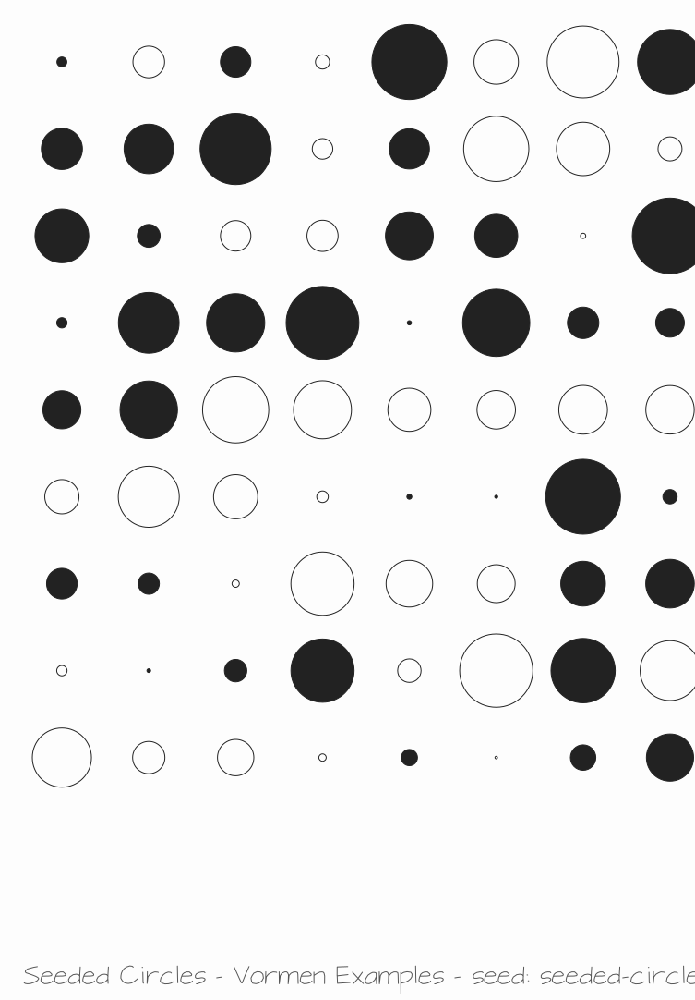
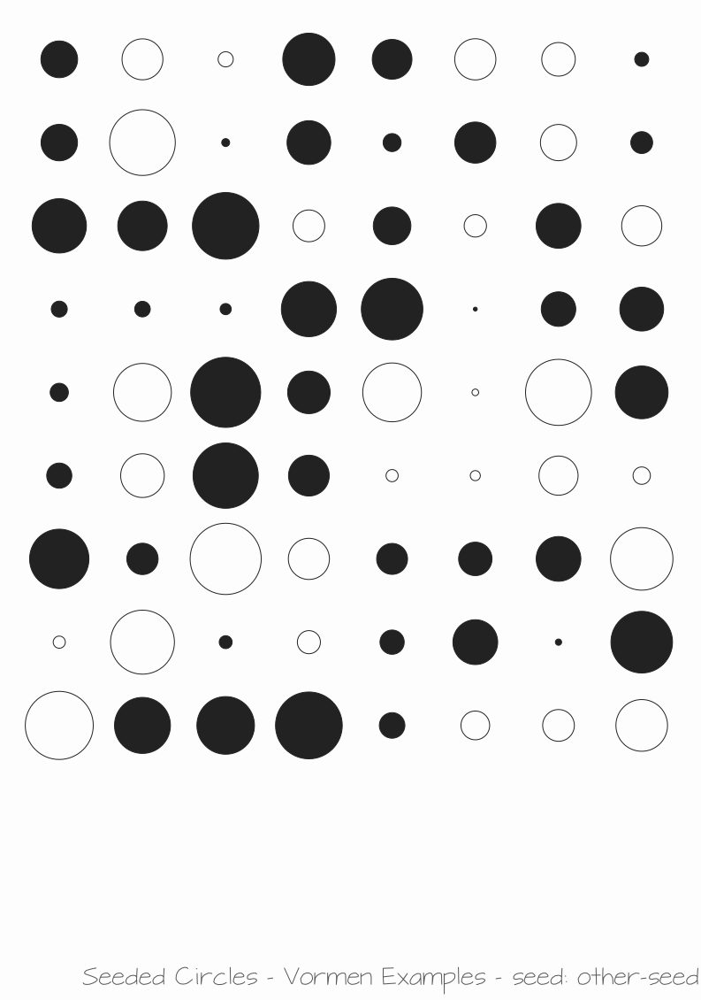

# Metadata & Caption

A seeded grid of circles on an A4 page. The drawing embeds metadata in the SVG:
a standard `<title>`/`<desc>` and a `<metadata>` block with RDF/XML (Dublin Core
/ Creative Commons, readable by Inkscape and `exiftool`), plus the generator
settings as JSON in the `vormen:` namespace. It also prints a caption — real SVG
text in the bottom margin — so printed or exported copies show the title, author
and seed without any tooling.

The seed is a setting: the two SVGs below only differ in the `seed` setting
(`seeded-circles` and `other-seed`), and each embeds the seed it was rendered
with, both in the `vormen:generator` metadata and in the caption.

Source: [examples/metadata.ts](../../../examples/metadata.ts)
