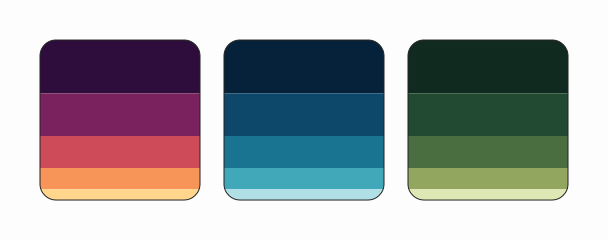

# Palettes

Loads a list of palettes from the example's palette library
(`examples/palettes/`, resolved relative to the example file so it works from
any working directory) with `loadPalette(name)`, and renders each palette as a
square with rounded corners. Inside each square, stacked horizontal bars - one
per color of the palette, each as wide as the square, with heights decreasing
per bar - fill the entire square, clipped to the rounded corners.

The palettes are plain `.gpl` files (`sunset`, `ocean`, `forest`) with a `Name:`
header and named colors, so they can be opened in GIMP or Inkscape as-is. Add
another `.gpl` file to `examples/palettes/` and its name to the list in the
example to render it too.

Source: [examples/palettes.ts](../../../examples/palettes.ts)
